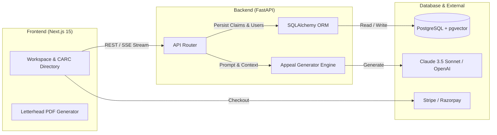

# ClaimGen AI — Healthcare Claim Denial Appeal Generator SaaS

[](https://nextjs.org/)
[](https://fastapi.tiangolo.com/)
[](https://github.com/pgvector/pgvector)
[](https://www.sqlalchemy.org/)
[](https://www.docker.com/)

> **An enterprise B2B SaaS platform that automates Level-1 medical claim denial appeal packets in under 15 seconds.**  
> Built with Next.js (App Router), Python FastAPI, SQLAlchemy ORM, PostgreSQL with `pgvector`, and dual Stripe / Razorpay checkout workflows.

---

## 🌟 Key Features

1. **Autonomous Level-1 Appeal Packet Generation:**
   - Pre-engineered for CARC/RARC denial reason codes (`CO-16`, `CO-50`, `CO-18`, `CO-97`, `PR-204`, `CO-29`, `CO-45`).
   - Cites federal statutes (**ERISA § 503 / 29 U.S.C. § 1133**, ACA appeals mandates), AMA CPT coding rules, and CMS Local Coverage Determinations (LCD).
   - Generates persuasive legal-clinical rebuttals tailored to specific payer rules (Aetna, UHC, Cigna, BCBS).

2. **Real-Time Clinical Workspace:**
   - 1-Click sample presets (`CO-16 Missing Info`, `CO-50 Medical Necessity`, `PR-204 Plan Exclusion`).
   - Server-Sent Events (SSE) streaming endpoint for live letter typing.
   - In-place rich text editor toggle and certified letterhead PDF export (`jspdf`).

3. **CARC / RARC Knowledge Directory:**
   - Interactive, searchable catalog of denial reason codes with common causes and proven appeal strategies.

4. **Database Persistence & ORM Layer:**
   - Relational data model with **SQLAlchemy ORM** mapping `users`, `claims`, and `payer_rules_kb`.
   - Vector embeddings support (`vector(1536)`) for semantic retrieval of payer policies.

5. **Multi-Gateway Subscriptions:**
   - **Stripe Checkout** (USD / Global) and **Razorpay** (INR / Domestic India) with webhook listeners.

---

## 🏗️ Architecture Flow



---

## 📁 Repository Structure

```
claimgen-ai/
├── backend/                       # Python FastAPI Service
│   ├── app/
│   │   ├── api/routes.py          # Endpoints: /appeals, /denial-codes, /payments
│   │   ├── core/
│   │   │   ├── config.py          # Environment settings & credentials
│   │   │   └── database.py        # SQLAlchemy engine, session maker & get_db
│   │   ├── models/
│   │   │   ├── schemas.py         # Pydantic request/response schemas
│   │   │   └── db_models.py       # SQLAlchemy ORM models (User, Claim, PayerRuleKB)
│   │   ├── services/
│   │   │   ├── appeal_generator.py# Claude 3.5 Sonnet / GPT-4 appeal logic
│   │   │   ├── carc_knowledge_base.py # CARC rules catalog
│   │   │   └── payment_service.py # Stripe & Razorpay checkout sessions
│   │   └── main.py                # FastAPI app & lifespan table setup
│   ├── database/schema.sql        # PostgreSQL + pgvector schema definition
│   ├── requirements.txt
│   └── .env.example
│
├── frontend/                      # Next.js 15 (App Router) + Tailwind CSS
│   ├── app/
│   │   ├── page.tsx               # High-converting landing page
│   │   ├── generate/page.tsx      # Flagship AI Appeal Workspace
│   │   ├── codes/page.tsx         # Searchable CARC Denial Directory
│   │   ├── pricing/page.tsx       # Tiered subscription plans
│   │   ├── api/appeals/           # Next.js API route bridge
│   │   └── api/auth/              # NextAuth credentials/JWT handler
│   ├── components/                # Navbar, Footer, UI components
│   └── globals.css                # Glassmorphism & SaaS design system
│
└── docker-compose.yml             # Multi-container Postgres + FastAPI + Next.js orchestration
```

---

## 🚀 Getting Started

### Prerequisites
- Node.js 18+ & npm
- Python 3.10+
- (Optional) Docker & Docker Compose

### 1. Backend Setup (FastAPI)

```bash
cd backend

# Create and activate virtual environment
python -m venv .venv

# Windows:
.venv\Scripts\activate
# macOS/Linux:
# source .venv/bin/activate

# Install dependencies
pip install -r requirements.txt

# Run backend development server
uvicorn app.main:app --reload --port 8000
```
- Interactive Swagger API Docs: **[http://localhost:8000/docs](http://localhost:8000/docs)**

---

### 2. Frontend Setup (Next.js)

```bash
cd frontend

# Install dependencies
npm install

# Run development server
npm run dev
```
- Open **[http://localhost:3000](http://localhost:3000)** in your browser.

---

### 3. Full Stack with Docker Compose

To spin up PostgreSQL (with pgvector), FastAPI backend, and Next.js frontend in one command:

```bash
docker compose up -d
```

---

## 🔒 Security & HIPAA Awareness

- **Stateless by Default**: Sensitive patient identifiers are formatted according to minimum necessary standards.
- **Environment Isolation**: API keys and database credentials are fully parameterized through `.env`.
